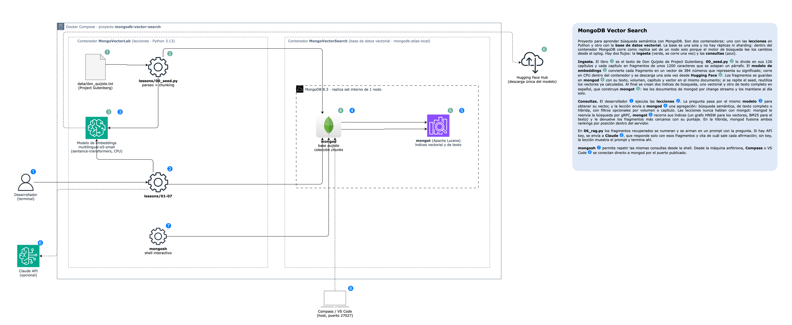

# MongoDB Vector Search

Proyecto para entender la **búsqueda semántica con MongoDB**: convertir texto en **embeddings**, guardarlos junto
a los documentos, indexarlos y buscarlos por significado con `$vectorSearch`. Incluye una aplicación en Python
(`pymongo` + `sentence-transformers`) que carga un libro real, *Don Quijote de la Mancha* (Project Gutenberg,
dominio público), en una sola colección (`chunks`), lo busca por significado, por palabras y de forma híbrida, y
responde preguntas sobre él con un **RAG**.



> Diagrama editable: [`docs/architecture.drawio`](docs/architecture.drawio). En verde, la carga del libro; en azul,
> las consultas.

## 1. Conceptos de MongoDB

### ¿Qué es MongoDB?

MongoDB es una base de datos **NoSQL orientada a documentos**. En lugar de tablas con filas y columnas, guarda
**documentos** parecidos a JSON. Un documento puede tener cualquier tipo de campo, incluido un array de cientos de
números: eso permite guardar el **vector** de un texto en el mismo documento que el texto.

| Concepto | Qué es | En este proyecto |
| --- | --- | --- |
| **Clúster** | Conjunto de procesos MongoDB que trabajan como una sola base de datos. | Un `mongod` + un `mongot` |
| **Database** | Contenedor lógico de colecciones. | `quijote` |
| **Collection** | Grupo de documentos, equivalente a una tabla. | `chunks`: los fragmentos del libro |
| **Document** | Un registro en formato BSON (JSON binario), de hasta 16 MB. Todo documento tiene un `_id` único. | Un fragmento de ~1200 caracteres con su vector |
| **Field** | Un par nombre-valor dentro del documento. | `text`, `chapter`, `embedding` |
| **Índice** | Estructura ordenada (B-tree) que evita recorrer toda la colección en una búsqueda exacta. | `{volume, chapter, position}` |
| **Índice de búsqueda** | Índice de Apache Lucene, separado de los normales, para búsquedas vectoriales o de texto completo. | `chunks_vector_index` y `chunks_text_index` |

Un documento de este proyecto:

```javascript
{
  _id: "v1-c008-000",                 // volumen 1, capítulo 8, fragmento 0
  volume: 1,                          // ┐ metadatos: sirven para filtrar las búsquedas
  chapter: 8,                         // ┘
  volume_title: "El ingenioso hidalgo don Quijote de la Mancha (1605)",
  chapter_title: "Del buen suceso que el valeroso don Quijote tuvo en la … aventura de los molinos de viento…",
  position: 0,
  text: "En esto, descubrieron treinta o cuarenta molinos de viento que hay en aquel campo…",
  embedding: [0.0213, -0.1131, 0.0874, …],  // 384 números: el significado de `text`
  model: "intfloat/multilingual-e5-small"   // el modelo que generó el vector
}
```

### Programas de MongoDB

| Programa | Qué hace | Aquí |
| --- | --- | --- |
| **`mongod`** | El **servidor de base de datos**: guarda los documentos, ejecuta las consultas y mantiene los índices normales. | `MongoVectorSearch` |
| **`mongot`** | El **motor de búsqueda** (Apache Lucene): mantiene los índices vectoriales y de texto completo y resuelve `$vectorSearch` y `$search`. | `MongoVectorSearch`, junto a `mongod` |
| **`mongosh`** | El **shell interactivo** de MongoDB, en JavaScript: `db.chunks.find()`, `db.chunks.getSearchIndexes()`. | En `MongoVectorLab` |
| **Driver (`pymongo`)** | Biblioteca con la que la aplicación habla con MongoDB. | Las lecciones |
| `mongodump` / `mongorestore` / `mongostat` / `mongotop` | Respaldo, restauración y monitoreo. | En `MongoVectorLab` |

### Cómo funciona la base de datos por dentro

La búsqueda vectorial la resuelven **dos procesos** que trabajan juntos:

```text
                  aplicación (pymongo / mongosh)
                              │  aggregate([{ $vectorSearch: … }])
                              ▼
                           mongod ────── gRPC: "busca esto" ──────► mongot (Lucene)
                    (guarda documentos)  ◄── ids + puntajes ─────── (guarda índices)
                              │                                        ▲
                              └──────── change streams (oplog) ────────┘
                                   mongot se entera de cada cambio
```

- **La aplicación solo habla con `mongod`.** `mongod` no sabe buscar vectores: le reenvía `$vectorSearch` y
  `$search` a `mongot`, recibe los `_id` más cercanos con su puntaje y devuelve los documentos completos.
- **`mongot` se mantiene al día solo.** Lee cada inserción, actualización o borrado de `mongod` mediante
  *change streams* y actualiza sus índices. Lo hace de forma **asíncrona**: un documento recién insertado tarda
  un momento en aparecer en las búsquedas (consistencia eventual). Los índices normales de `mongod`, en cambio,
  se actualizan en la misma escritura.
- **Por qué hace falta un replica set.** Los change streams leen el *oplog*, el registro de cambios que solo
  existe en un replica set. Por eso `mongod` corre como **replica set de un solo nodo**: tiene oplog, pero sigue
  siendo una sola base de datos, sin copias ni sharding.
- **`mongot` no guarda tus datos.** Si se borran sus índices, los reconstruye leyendo `mongod`.
- **WiredTiger, journal e índices B-tree** funcionan igual que en cualquier `mongod`: sin índice, una consulta
  revisa todos los documentos (`COLLSCAN`); con índice, solo los que coinciden (`IXSCAN`).

## 2. Búsqueda semántica

### Embeddings

Un **embedding** es una lista de números (un vector) que representa el **significado** de un texto. Un modelo
entrenado para esto pone cerca textos que dicen lo mismo con otras palabras, aunque no compartan ninguna:

```text
"don Quijote ataca a unos gigantes"        → [ 0.021, -0.113,  0.087, …]  ┐ cerca: misma idea
"arremetió contra los molinos de viento"   → [ 0.019, -0.098,  0.091, …]  ┘
"Sancho cena queso y pan"                  → [-0.140,  0.054, -0.012, …]    lejos
```

| Pieza | Qué es | En este proyecto |
| --- | --- | --- |
| **Modelo de embeddings** | Red neuronal que convierte texto en un vector. La pregunta y los documentos **deben** pasar por el mismo modelo, o sus vectores no son comparables. | `intfloat/multilingual-e5-small`, en CPU, sin API key |
| **Dimensiones** | Cuántos números tiene cada vector. El índice debe declarar exactamente la misma cantidad. | 384 |
| **Similitud** | Cómo se mide la cercanía entre dos vectores: `cosine` (el ángulo), `dotProduct` (producto punto, exige vectores normalizados) o `euclidean` (distancia). | `cosine`, con vectores normalizados |
| **Prefijos** | Los modelos E5 esperan `query: ` delante de las preguntas y `passage: ` delante de los textos indexados. | `src/lab/embeddings.py` |
| **Ventana** | Máximo de tokens que el modelo lee; lo que sobra se descarta sin aviso. | 512 tokens |

### Chunking: partir el texto

Un capítulo entero no cabe en la ventana del modelo, y aunque cupiera, un solo vector para tantos temas a la vez
sería demasiado genérico. Por eso el libro se parte en **fragmentos** (*chunks*), y cada uno tiene su propio
vector. Este proyecto junta párrafos completos hasta ~1200 caracteres (unos 300 tokens), parte por frases los
párrafos más largos y **solapa** un párrafo entre fragmentos consecutivos, para que una idea cortada en el borde
quede completa en uno de los dos. Resultado: 126 capítulos → **2424 fragmentos**.

### El índice vectorial

```javascript
{
  fields: [
    { type: "vector", path: "embedding", numDimensions: 384, similarity: "cosine" },
    { type: "filter", path: "volume" },      // campos por los que se podrá pre-filtrar
    { type: "filter", path: "chapter" }
  ]
}
```

`mongot` organiza los vectores en un grafo **HNSW** (*Hierarchical Navigable Small World*): cada vector queda
conectado con sus vecinos cercanos, en varios niveles. Para buscar, recorre el grafo saltando hacia vectores cada
vez más parecidos a la consulta, **sin compararla con todos**. Es una búsqueda **aproximada** (ANN): muy rápida,
pero puede perderse algún vecino real.

### `$vectorSearch`

Es una etapa de agregación y debe ser la **primera** del pipeline:

```javascript
db.chunks.aggregate([
  { $vectorSearch: {
      index: "chunks_vector_index",
      path: "embedding",
      queryVector: [ … ],          // la pregunta, convertida con el MISMO modelo
      numCandidates: 100,          // vecinos que explora el grafo HNSW
      limit: 5,                    // resultados que devuelve
      filter: { volume: 2 }        // opcional: pre-filtro por campos tipo "filter"
  } },
  { $project: { text: 1, chapter: 1, score: { $meta: "vectorSearchScore" } } }
])
```

| Parámetro | Qué controla |
| --- | --- |
| **`numCandidates`** | Cuántos candidatos explora el grafo antes de quedarse con los mejores. Más candidatos = mejor *recall*, pero más lento. Lo habitual es de 10 a 20 veces `limit`. |
| **`limit`** | Cuántos documentos devuelve. |
| **`filter`** | Pre-filtro con operadores MQL (`$eq`, `$in`, `$gte`, `$and`…) sobre los campos declarados como `filter`. Se aplica **antes** de buscar vecinos, así que no reduce la cantidad de resultados como lo haría un `$match` posterior. |
| **`exact: true`** | Búsqueda exacta (ENN): compara con todos los vectores. Sirve para medir cuánto pierde la aproximación. |
| **`vectorSearchScore`** | Puntaje de similitud de cada resultado. Cada modelo tiene su propio rango; lo que importa es el **orden**. |

Después de `$vectorSearch` el pipeline sigue siendo normal: `$group`, `$lookup`, `$sort`, etc.

### Semántica, texto completo e híbrida

| Búsqueda | Etapa | Encuentra | Le cuesta |
| --- | --- | --- | --- |
| **Semántica** | `$vectorSearch` | Paráfrasis, sinónimos, la idea aunque se diga con otras palabras | Nombres propios y términos raros ("Clavileño", "Barataria") |
| **Texto completo** | `$search` | Términos exactos y nombres propios. Usa el analizador `lucene.spanish` (ignora tildes, plurales y palabras vacías) y puntúa con **BM25** | Preguntas formuladas con palabras distintas a las del texto |
| **Híbrida** | `$rankFusion` | Lo mejor de ambas: ejecuta las dos búsquedas y fusiona sus rankings | — |

Los puntajes de las dos búsquedas no se pueden comparar (uno es un coseno y el otro BM25), así que `$rankFusion`
usa **Reciprocal Rank Fusion**, que solo mira la **posición** de cada documento en cada lista:

```text
score(doc) = Σ  1 / (60 + posición del doc en cada búsqueda)
```

Un fragmento que sale tercero en la semántica y primero en la de texto suma `1/63 + 1/61`, y le gana a uno que solo
aparece primero en una de las dos. `$rankFusion` existe desde MongoDB 8.1.

### RAG: recuperar, aumentar, generar

**RAG** (*Retrieval-Augmented Generation*) es responder preguntas con un modelo de lenguaje dándole como contexto
los fragmentos recuperados de tu base de datos:

```text
pregunta ──► 1. Recuperar ──────────► 2. Aumentar ────────────────► 3. Generar
             búsqueda híbrida          prompt = instrucciones         el LLM responde
             en MongoDB                + fragmentos + pregunta        citando [1], [2]…
```

La calidad depende sobre todo del paso 1: si el fragmento con la respuesta no llega al prompt, el modelo no
puede usarlo. Aquí el paso 3 usa Claude y es opcional (requiere API key).

### Las decisiones que más afectan la calidad

| Decisión | Efecto | En este proyecto |
| --- | --- | --- |
| **Modelo de embeddings** | Tiene que entender el idioma y el tipo de texto. Más dimensiones no siempre es mejor. | `multilingual-e5-small` (384). `multilingual-e5-base` (768) no acertó más y tardó 2,6 veces más en procesar el libro. |
| **Tamaño del fragmento** | Muy chico pierde contexto; muy grande diluye el significado. | ~1200 caracteres con solapamiento de un párrafo |
| **Tipo de búsqueda** | La híbrida suele ganar cuando las preguntas mezclan ideas y nombres propios. | Híbrida: 8/10 aciertos en primer lugar, contra 6/10 de la semántica y 6/10 de la de texto |
| **`numCandidates`** | Más candidatos mejora el *recall* a cambio de velocidad. | 20 × `limit` |
| **Metadatos para filtrar** | Permiten acotar la búsqueda (por volumen, capítulo, fecha, cliente…) dentro del mismo índice. | `volume` y `chapter` |

Cada decisión se mide con la lección `07_evaluate.py`.

## 3. Cómo está armado el proyecto

| Contenedor | Imagen / proceso | Puerto interno | Puerto en el host | Rol |
| --- | --- | --- | --- | --- |
| `MongoVectorSearch` (`mongodb`) | `mongodb/mongodb-atlas-local` (MongoDB 8.3) · `mongod` + `mongot` | 27017 | 27027 | La base de datos vectorial |
| `MongoVectorLab` | Python 3.13 · pymongo · sentence-transformers · mongosh · JupyterLab | 8888 | 8888 | Donde se ejecutan las lecciones y el sandbox |

**Arranque:**

1. Se inicia `MongoVectorSearch`: la imagen arranca `mongod` como replica set de un nodo y luego `mongot`. No hace
   falta un job de inicialización.
2. `MongoVectorLab` espera a que `mongod` sea PRIMARY y descarga el modelo de embeddings (una sola vez).
3. `python lessons/00_seed.py` carga el libro y crea los índices.

Los datos, los índices de `mongot` y el modelo descargado se guardan en volúmenes, así que sobreviven a los
reinicios.

La aplicación se conecta con: `mongodb://mongodb:27017/?directConnection=true`.

```text
.devcontainer.json            # Dev Container de VS Code
.docker/
  Dockerfile                  # img-base (Python + mongosh) -> img-lab (torch CPU)
  docker-compose.yml          # Contenedor MongoVectorLab
  vector-search.yml           # mongod + mongot (mongodb-atlas-local)
  entrypoint.sh               # Instala requirements, espera a mongod y descarga el modelo
.envs/mongo.env               # MONGO_URI, MONGO_DB y EMBEDDING_MODEL
data/don_quijote.txt          # El libro (Project Gutenberg #2000)
docs/architecture.drawio      # Diagrama
docs/teoria/                  # Teoría de cada tema (01-06), para leer junto a las lecciones
src/lab/                      # Cliente, funciones para imprimir, libro + chunking, embeddings y búsqueda
lessons/                      # Lecciones 00-07
notebooks/sandbox.ipynb       # Sandbox para experimentar con todo lo anterior
```

## 4. Puesta en marcha

**Con VS Code**: `Dev Containers: Reopen in Container`.

**Con la terminal**:

```bash
cd .docker
docker compose -f docker-compose.yml -f vector-search.yml up -d --build
docker exec MongoVectorLab .docker/entrypoint.sh        # solo la primera vez
docker exec -it MongoVectorLab bash                     # entrar al contenedor
```

Dentro del contenedor (`/app`):

```bash
python lessons/00_seed.py      # siempre primero (2-3 min la primera vez: calcula 2424 embeddings)
python lessons/01_embeddings.py # y así con las demás, en orden
mongosh "$MONGO_URI"           # shell interactivo
```

Para que la lección 06 genere respuestas con Claude, crea `.envs/anthropic.env` con `ANTHROPIC_API_KEY=...` y
vuelve a ejecutar el `docker compose ... up -d`. Sin API key, la lección recupera los fragmentos y muestra el prompt.

Apagar (`stop`) o borrar todo, incluidos los datos y el modelo descargado (`down -v`):

```bash
cd .docker
docker compose -f docker-compose.yml -f vector-search.yml down -v
```

### Abrir la base en MongoDB Compass

**New Connection** → pega la URI → **Save & Connect**:

```text
mongodb://localhost:27027/?directConnection=true
```

`directConnection=true` es necesario. Sin él, Compass le pregunta a `mongod` por su replica set, recibe el nombre
interno del contenedor (`mongodb:27017`), que tu equipo no conoce, y la conexión falla.

Qué puedes comprobar:

- En `quijote.chunks` están los 2424 fragmentos con su vector (el campo `embedding`, un array de 384 números).
- En **Indexes → Search Indexes** aparecen los dos índices de búsqueda con su estado. Mientras corre la lección 03
  aparece y desaparece un tercero, `chunks_vector_int8`.
- Desde **Aggregations** puedes probar `$search` y `$vectorSearch` (con el `embedding` de otro documento como
  `queryVector`).

## 5. Lecciones

| Lección | Qué hace | Qué observar |
| --- | --- | --- |
| `00_seed.py` | Parsea el libro en 126 capítulos, lo parte en 2424 fragmentos, calcula sus embeddings, borra la base `quijote`, inserta los documentos con `insert_many` y crea el índice normal y los dos de búsqueda. | Los índices de búsqueda pasan de `PENDING` a listos mientras `mongot` los construye. Al repetir el seed reutiliza los vectores que ya calculó con el mismo modelo y el mismo texto: tarda segundos. |
| `01_embeddings.py` | Convierte frases en vectores y compara su similitud con una pregunta; compara con y sin prefijos E5; embebe un capítulo completo. | Los textos con la misma idea quedan primeros aunque no compartan palabras. El capítulo completo (4596 tokens) da el mismo vector que sus primeros 3000 caracteres: el modelo descarta lo que pasa de 512 tokens. |
| `02_documents.py` | **Read** con proyección sin el vector; el solapamiento entre fragmentos; cuánto pesa el vector (`$bsonSize`) y cuánto ocuparía como `binData` float32, int8 o bit; **Create**, **Update** y **Delete** de un documento con su vector. | El vector pesa ~5 veces más que el texto. Si cambias el texto sin recalcular el vector, el vector deja de describirlo. |
| `03_search_indexes.py` | Índices normales vs de búsqueda; definición del índice vectorial; crea un índice cuantizado (`quantization: scalar`) y lo ve construirse; inserta un documento y mide cuándo lo ve `mongot`. | `PENDING` → `BUILDING` → `READY`. `find` ve el documento al instante; `$search`, alrededor de un segundo después (consistencia eventual). |
| `04_vector_search.py` | `$vectorSearch` con una pregunta; exacta (ENN) vs aproximada (ANN) con distintos `numCandidates`; pre-filtros; pre-filtro vs `$match` posterior; `$group` después de buscar; "más como éste" con un vector guardado. | Con pocos candidatos el *recall* puede bajar. El `$match` posterior deja 1 resultado; el `filter`, 5. Acepta otra consulta: `python lessons/04_vector_search.py "…"`. |
| `05_hybrid_search.py` | `$search` con BM25, frase exacta con resaltado y conteo por capítulo; top 3 de semántica, texto e híbrida para dos preguntas; `$rankFusion` con `scoreDetails`. | Ninguna búsqueda acierta siempre; los fragmentos que aparecen en las dos listas suben en la híbrida. `scoreDetails` muestra la posición que tuvo cada fragmento en cada búsqueda. |
| `06_rag.py` | **RAG**: recupera 5 fragmentos (híbrida), arma el prompt numerado y, si hay API key, Claude responde citándolos. | Cada fragmento llega con su referencia (volumen, capítulo), para que la respuesta pueda citarlos. Acepta otra pregunta como argumento. |
| `07_evaluate.py` | Hace 10 preguntas cuya respuesta está en un capítulo conocido y mide en qué posición aparece con cada búsqueda. | *hit@1* y *hit@5* por búsqueda, y su latencia. Vuelve a correrla cada vez que cambies el modelo, el chunking o la búsqueda. |

Para volver al estado inicial: `python lessons/00_seed.py`.

La teoría de cada tema, con más detalle que este README, está en [`docs/teoria/`](docs/teoria):

| Teoría | Tema | Lecciones |
| --- | --- | --- |
| [01](docs/teoria/01-embeddings.md) | Qué es un embedding, similitud y el modelo | `01` |
| [02](docs/teoria/02-ingesta-y-chunking.md) | Parseo, chunking y el documento | `00`, `02` |
| [03](docs/teoria/03-indices-de-busqueda.md) | Índices de búsqueda y `mongot` | `03` |
| [04](docs/teoria/04-busqueda-semantica.md) | `$vectorSearch`, filtros y "más como éste" | `04` |
| [05](docs/teoria/05-busqueda-hibrida.md) | Texto completo, `$rankFusion` y RRF | `05` |
| [06](docs/teoria/06-rag.md) | RAG y evaluación | `06`, `07` |

### Sandbox

[`notebooks/sandbox.ipynb`](notebooks/sandbox.ipynb) reúne todo en un solo lugar para experimentar: conexión y
estado de la base, funciones listas (`buscar`, `leer`, `similitud`, `comparar`), similitud entre tus frases,
`$vectorSearch` armado a mano, operadores de `$search`, `$rankFusion` con pesos, un pipeline libre, un mapa 2D de
los embeddings, una colección `sandbox` con **tus propios textos** y su índice, y el RAG. Las celdas marcadas
**Juega aquí** están hechas para cambiarlas.

Necesita el seed cargado. Hay dos formas de abrirlo:

- **VS Code (Dev Container)**: abre el archivo y elige el kernel de Python 3.13 del contenedor. No usa puertos.
- **Navegador (JupyterLab)**: el contenedor publica el puerto 8888 solo para esto.

  ```bash
  docker exec -it MongoVectorLab jupyter lab --ip 0.0.0.0 --port 8888 --no-browser --notebook-dir /app
  ```

  Abre en tu equipo la URL `http://127.0.0.1:8888/lab?token=…` que imprime el comando, y `Ctrl+C` para cerrarlo.

## 6. Comandos útiles

En `mongosh "$MONGO_URI"`:

```javascript
use quijote
db.chunks.countDocuments()                                // 2424 fragmentos
db.chunks.findOne({ chapter: 8 }, { embedding: 0 })       // un documento sin el vector
db.chunks.getSearchIndexes()                              // índices de búsqueda: status y definición

// Búsqueda semántica con el vector de un fragmento guardado (no hace falta el modelo)
const ref = db.chunks.findOne({ _id: "v1-c008-001" })
db.chunks.aggregate([
  { $vectorSearch: { index: "chunks_vector_index", path: "embedding", queryVector: ref.embedding,
                     numCandidates: 100, limit: 5, filter: { volume: 2 } } },
  { $project: { chapter: 1, chapter_title: 1, score: { $meta: "vectorSearchScore" } } }
])

// Lo mismo, pero exacta (ENN): compara con los 2424 vectores
db.chunks.aggregate([
  { $vectorSearch: { index: "chunks_vector_index", path: "embedding", queryVector: ref.embedding,
                     exact: true, limit: 5 } },
  { $project: { chapter: 1, score: { $meta: "vectorSearchScore" } } }
])

// Texto completo
db.chunks.aggregate([
  { $search: { index: "chunks_text_index", text: { query: "Rocinante", path: "text" } } },
  { $limit: 3 },
  { $project: { chapter: 1, score: { $meta: "searchScore" } } }
])
```

Experimento desde el host:

```bash
# Reiniciar la base: los índices de mongot están en un volumen y no hay que reconstruirlos
docker restart MongoVectorSearch
docker exec MongoVectorLab bash -c 'mongosh "$MONGO_URI" --quiet --eval "db.getSiblingDB(\"quijote\").chunks.getSearchIndexes().map(i => i.name + \" \" + i.status)"'
#   -> [ 'chunks_vector_index READY', 'chunks_text_index READY' ]   (tras unos segundos)
```

## Notas

- **Sin autenticación**: el proyecto es solo para aprendizaje local; la base se publica en `localhost:27027`
  únicamente para abrirla con Compass. En producción se usan usuarios con roles mínimos y TLS.
- **Imagen `mongodb-atlas-local`**: trae `mongod` y `mongot` en un solo contenedor y es la forma oficial de probar
  Vector Search en local. Se usa la etiqueta `preview` (MongoDB 8.3), fijada por digest para que no cambie sola.
  MongoDB 9 Community también tiene Vector Search, pero requiere `mongot` en un contenedor aparte.
- **Sin GPU**: el modelo de embeddings corre en CPU (`torch` CPU). Es suficiente para un libro; para millones de
  documentos se usa GPU o un servicio de embeddings.
